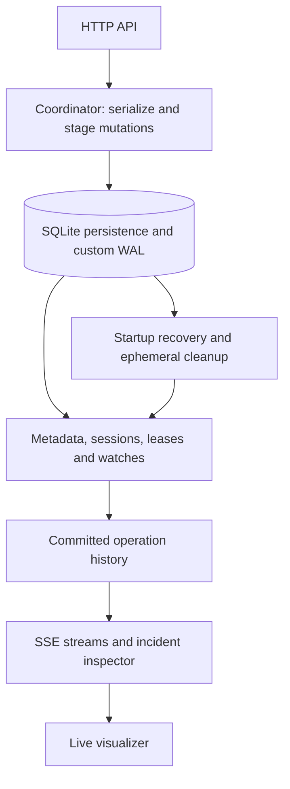
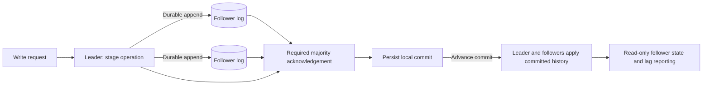

# Coordination Service

[](https://github.com/Yumekaz/Coordination-service/actions/workflows/verification.yml)

**A coordination engine for hierarchical metadata, sessions, leases, watches and observable recovery.**

The service combines a FastAPI interface with SQLite-backed persistence, committed operation history and optional leader/follower replication. Its live visualizer connects metadata changes to session ownership, watch firings, cleanup cascades and recovery reports.

## Capabilities

| Area | Behavior |
| --- | --- |
| Metadata | Hierarchical nodes, child listing and version-checked updates |
| Sessions | Heartbeats, expiry and ephemeral ownership cleanup |
| Leases | Owner-checked acquire/renew/release, independent TTL and queued waiters |
| Watches | One-shot registrations with event-type filtering |
| History | Committed sequence history and operation incident inspection |
| Recovery | WAL replay, session/ephemeral cleanup and startup reports |
| Cluster mode | Durable replicated log, optional write quorum, leadership handoff and follower catch-up |
| Visualizer | Live tree, timeline, inspector, session inventory and SSE updates |

It is an independent coordination service, not a drop-in ZooKeeper replacement or a complete Raft implementation.

## Quick start: Linux/macOS

Use Python **3.12 or 3.14**, the versions covered by CI.

```bash
git clone https://github.com/Yumekaz/Coordination-service.git
cd Coordination-service
python3 -m venv .venv
. .venv/bin/activate
python -m pip install -r requirements.txt
python main.py
```

Open **http://127.0.0.1:8000/** for the visualizer, or **http://127.0.0.1:8000/docs** for the API reference.

## Quick start: Windows PowerShell

After cloning and entering the repository:

```powershell
python -m venv .venv
.\.venv\Scripts\python.exe -m pip install -r requirements.txt
.\.venv\Scripts\python.exe main.py
```

Both paths use the repository's default local database. Use a dedicated working directory/database for experiments that intentionally crash processes or manipulate persistence.

## Try the product

- Click **Run Demo** to populate real committed state and its timeline.
- Create a session with **+ Session**, then create a node with **+ Node**.
- Inspect a session or operation to follow ownership and cleanup effects.
- Open a path incident to see its causal chain, affected paths and watch history.

The [demo guide](demos/README.md) covers locks, watches, service discovery, election-style ownership and crash recovery. Demo scenarios demonstrate selected behavior; they are not universal distributed-consensus proofs.

## Architecture

The Coordinator serializes local mutations. Persistence succeeds before planned in-memory changes become visible.



Cluster replication is an additional path. In quorum-enabled mode, leader writes use durable replica acknowledgements before local application; commit advancement lets followers apply committed entries.



This second diagram describes the quorum-enabled cluster path, not the standalone default. Majority heartbeat leases and term/log-freshness checks provide fencing mechanisms, but do not constitute a formal consensus proof.

## Behavior and guarantees

- Version-checked updates reject stale CAS writes with `409 Conflict`.
- Leases are checked against their owner; their tokens derive from committed create order and can be used by downstream consumers for fencing.
- Watches fire once per registration in the implemented watch state machine; this is not an exactly-once network-delivery guarantee.
- Failed local persistence does not intentionally expose staged tree/session changes.
- Recovery replays durable operations, expires old sessions, removes dead ephemerals and records a startup report.
- Followers remain read-only and catch up from committed history; divergent local histories can be rebuilt from leader snapshots.
- Quorum-enabled leaders durably append to a majority and distinguish committed history from provisional reservations.
- Leader heartbeat leases, term-aware messages and log-freshness votes guard the tested handoff/failover paths.

Cluster-local lease expiry, election/contact age, prepare-reservation expiry, handoff confirmation and peer-alignment waits use monotonic elapsed time. Peer ACK ordering and replication latency also use this clock, so NTP/manual wall-clock jumps cannot reorder ACKs or change these local deadlines. Monotonic values are neither persisted nor sent to peers; restarts retain durable term/vote/membership fences but do not restore an old process's lease or prepare reservation.

Status fields such as `last_leader_contact_at`, `leader_lease_until`, `last_ack_at`, `last_sync_at` and `applied_at` remain wall-clock diagnostics. In particular, `leader_lease_until` records the civil-time estimate at renewal; after a clock adjustment, use `leader_lease_expired`/`write_quorum_ready`, not a client-side subtraction from that timestamp. This hardening does not change session/client-lease TTL semantics, compensate for clock-rate drift or guarantee expiry across host suspend; waits can also exceed their budget by an in-flight RPC or scheduling delay. See the [clock-jump validation record](validation-runs/hardening-20261023/README.md).

Cluster safety still has explicit boundaries: no complete log-matching/overwrite protocol, no formal joint-consensus membership changes and no claim of production split-brain-proof consensus.

## API map

| Surface | Representative endpoints |
| --- | --- |
| Metadata | /api/node/create, /api/node/get, /api/node/set, /api/node/delete, /api/node/list_children |
| Sessions | /api/session/open, /api/session/heartbeat, /api/session/close, /api/sessions |
| Watches | /api/watch/register, /api/watch/wait, /api/watch/unregister |
| Leases | /api/lease/acquire, /api/lease/get, /api/lease/renew, /api/lease/release |
| History | /api/operations, /api/operations/tail, /api/operations/{sequence_number}/incident |
| Recovery | /api/recovery/last |
| Cluster | /api/cluster/status, /api/cluster/transfer-leadership |
| Streams | /api/stream/operations, /api/stream/sessions |

See the running application's `/docs` page for request schemas and HTTP methods. Internal replication endpoints are a separate, token-protected interface.

## Configuration and security

The default bind address is **127.0.0.1:8000**. Relevant environment variables include:

| Variable | Purpose |
| --- | --- |
| COORD_HOST / COORD_PORT | Explicit bind address and port |
| COORD_DB_PATH | Local SQLite database location |
| COORD_REPLICATION_TOKEN | Shared, non-empty token required for configured clustering |
| COORD_CORS_ORIGINS | Additional explicitly allowed browser origins |
| COORD_LOG_LEVEL | Logging level |

Replication-token protection is not public-client authentication. Keep the admin/API local or provide a separately authenticated, TLS-protected access layer before public exposure. Insecure replication opt-ins are reserved for isolated tests, not normal deployment.

[render.yaml](render.yaml) describes a **single-node demo** with a persistent disk. It is not a horizontally scaled cluster deployment or proof that a public instance has suitable access controls.

## Verification

From an activated Linux/macOS virtual environment:

```bash
python -m pytest -q
```

Windows PowerShell:

```powershell
.\.venv\Scripts\python.exe -m pytest -q
```

The October 8 retained acceptance run passed **320 tests**. The required [Verification workflow](.github/workflows/verification.yml) runs Python 3.12/3.14, requires the complete suite and rejects prerequisite skips.

Coverage includes metadata/session atomicity, WAL recovery, leases, watches, HTTP/SSE behavior, quorum rollback, leadership handoff/removal, stale-leader rejection, follower restart replay and divergent-history rebuilding. [FailForge](https://github.com/Yumekaz/FAILFORGE) adds covered baseline and seeded fault campaigns; its pinned target revisions are recorded separately.

See [Cairn's validation record](https://github.com/Yumekaz/Cairn/blob/main/docs/VALIDATION_2026-10.md) for retained cross-project results and scope limits.

## Source map

[Coordinator](coordinator.py) · [Metadata tree](metadata_tree.py) · [Sessions](session_manager.py) · [Watches](watch_manager.py) · [Operation history](operation_log.py) · [Persistence](persistence.py) · [Recovery](recovery.py) · [Tests](tests)

Related projects: [Cairn](https://github.com/Yumekaz/Cairn) uses Mini-Docker/DuraFlow for deployments; Coordination and MiniDB are connected verification targets, not Cairn's production metadata dependencies.
